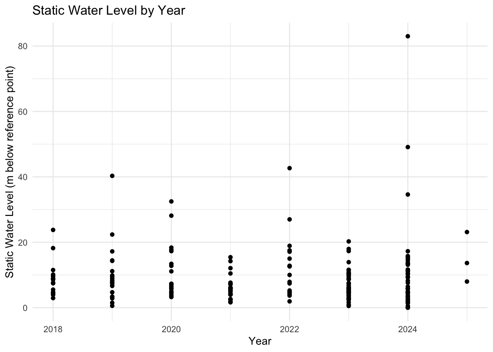

# Borehole Forensics 4 - Pumping Test 2018 - 2024

A data package published by [openwashdata](https://openwashdata.org).

This dataset contains borehole forensic pumping test data, capturing key
parameters related to groundwater extraction, borehole performance, and
water quality assessments. It includes information on the test
conditions, water levels, pumping rates, flow measurement methods, and
water quality indicators such as pH, turbidity, and electrical
conductivity.

The dataset also documents permissions granted for testing, equipment
used, and observations on borehole performance, such as whether the
water level stabilized during pumping and whether the borehole passed
the test.

Potential Uses of the Dataset

1.  Hydrogeological Analysis: Evaluating groundwater availability and
    borehole efficiency.

2.  Environmental Studies: Assessing water quality parameters.

3.  Infrastructure Planning: Supporting water resource management and
    borehole maintenance decisions.

4.  Regulatory Compliance: Ensuring boreholes meet required operational
    standards.

The data was collected by BASEFlow with funding from the [Open Research
Data Program of the ETH
Board](https://ethrat.ch/en/eth-domain/open-research-data/).

## Installation

You can install the development version of boreholeforensicspumpingtest
from [GitHub](https://github.com/) with:

``` r

# install.packages("devtools")
devtools::install_github("openwashdata/boreholeforensicspumpingtest")
```

``` r

## Run the following code in console if you don't have the packages
## install.packages(c("dplyr", "knitr", "readr", "stringr", "gt", "kableExtra"))
library(dplyr)
library(knitr)
library(readr)
library(stringr)
library(gt)
library(kableExtra)
library(ggplot2)
library(lubridate)
```

Alternatively, you can download the individual datasets as a CSV or XLSX
file from the table below.

1.  Click Download CSV. A window opens that displays the CSV in your
    browser.
2.  Right-click anywhere inside the window and select “Save Page As…”.
3.  Save the file in a folder of your choice.

| dataset | CSV | XLSX |
|:---|:---|:---|
| boreholeforensicspumpingtest | [Download CSV](https://github.com/openwashdata/boreholeforensicspumpingtest/raw/main/inst/extdata/boreholeforensicspumpingtest.csv) | [Download XLSX](https://github.com/openwashdata/boreholeforensicspumpingtest/raw/main/inst/extdata/boreholeforensicspumpingtest.xlsx) |

## Data

The package provides access to the Borehole Forensics 4 - Pumping Test
conducted between 2018 and 2024

``` r

library(boreholeforensicspumpingtest)
```

### boreholeforensicspumpingtest

The dataset `boreholeforensicspumpingtest` has 203 observations and 44
variables

``` r

boreholeforensicspumpingtest |> 
  head(3) |> 
  gt::gt() |>
  gt::as_raw_html()
```

| date_of_test | administrative_region | latitude | longitude | name | type_of_waterpoint | description | type_of_test | pumping_test_possible | pumping_test_not_possible_reason | water_point_committee_permission | district_water_office_permission | static_water_level | water_level_reference_point | other_water_level_reference_point | reference_level | pump_intake_depth | total_hole_depth | was_a_water_level_logger_used | was_a_flow_meter_used | other_flow_meter_used | bucket_size_in_litres | index_1 | time_in_mins | water_level_in_mbrp | flowmeter_total | flow_rate_in_liters_per_second | flow_rate_method | index_2 | time_of_sample_in_min | ec_in_ms_per_cm | tds_ppt | temperature_in_celcius | ph | turbidity_ntu | Imhoff_cone_cubic_centimeter_per_liter | water_level_stabilised | dwl_at_0.25lps | max_pumping_rate | dwl_at_max_rate | silt_ejected_during_test | borehole_passed | other_borehole_pass_reason | comments_on_pumping_test |
|---:|:---|---:|---:|:---|:---|:---|:---|:---|:---|:---|:---|---:|:---|:---|---:|---:|---:|:---|:---|:--:|---:|:--:|:--:|:--:|:--:|:--:|:--:|:--:|:--:|:--:|:--:|:--:|:--:|:--:|:--:|:---|---:|---:|---:|:---|:---|:--:|:---|
| 2018-10-09 | STA Sandareki, Chiradzulu, Malawi | -15.68837 | 35.29993 | Makuwa secondary school borehole 1 | Borehole or tubewell | Near makuwa secondary school | Step Drawdown | Yes | NA | Yes | Yes | 11.50 | Top of Pedestal | NA | 0.44 | 22 | 24.5 | Yes | Digital | NA | 20 | NA | NA | NA | NA | NA | NA | NA | NA | NA | NA | NA | NA | NA | NA | Yes | 14.57 | 0.5 | 16.95 | Constantly | Yes | NA | 3.25ppm iron. 0ppb arsenic. Large amount of sediment ejected. |
| 2018-10-10 | TA Nchema, Chiradzulu, Malawi | -15.58221 | 35.18867 | Chindunguli borehole 2 | Borehole or tubewell | Near Juma’s Maizemill | Step Drawdown | Yes | NA | Yes | Yes | 10.10 | Top of Pedestal | NA | 0.51 | 45 | 47.0 | Yes | Digital | NA | 20 | NA | NA | NA | NA | NA | NA | NA | NA | NA | NA | NA | NA | NA | NA | Yes | 15.00 | 0.5 | 34.00 | No | NA | NA | All imhoff cone sediment readings less than 0.1 |
| 2018-10-24 | STA Mpunga, Chiradzulu, Malawi | -15.82110 | 35.25589 | Nangwinya Borehole | Borehole or tubewell | Between Namitambo and Namitokoma | Step Drawdown | Yes | NA | Yes | Yes | 4.61 | Top of Pedestal | NA | 0.51 | 41 | 42.8 | Yes | Digital | NA | 20 | NA | NA | NA | NA | NA | NA | NA | NA | NA | NA | NA | NA | NA | NA | Yes | 9.63 | 1.0 | 32.27 | No | NA | NA | Generator turned off due to fault near end of third step. |

For an overview of the variable names, see the following table.

| variable_name | variable_type | description |
|:---|:---|:---|
| date_of_test | Date | Date the borehole pumping test was conducted. |
| administrative_region | character | Geographic region where the water point is located. |
| latitude | numeric | Latitude coordinate of the water point. |
| longitude | numeric | Longitude coordinate of the water point. |
| name | character | Name of the water point or borehole. |
| type_of_waterpoint | character | Classification of the water point. |
| description | character | A brief description of the water point. |
| type_of_test | character | Type of pumping test conducted on the borehole. |
| pumping_test_possible | character | Indicates if the pumping test was successfully completed. |
| pumping_test_not_possible_reason | character | Reason why the pumping test could not be completed, if applicable. |
| water_point_committee_permission | character | Indicates whether the water point committee approved the test. |
| district_water_office_permission | character | Indicates whether the district water office approved the test. |
| static_water_level | numeric | Water level below the reference point before the test started (in meters). |
| water_level_reference_point | character | Reference point used to measure the water level. |
| other_water_level_reference_point | character | Additional reference point for measuring water level, if applicable. |
| reference_level | numeric | Measurement of the reference level relative to ground level (in meters). |
| pump_intake_depth | numeric | Depth of the pump intake within the borehole (in meters). |
| total_hole_depth | numeric | Total depth of the borehole (in meters). |
| was_a_water_level_logger_used | character | Indicates if a water level logger was used during the test. |
| was_a_flow_meter_used | character | Indicates if a flow meter was used during the pumping test. |
| other_flow_meter_used | logical | Indicates if an alternative flow meter was used during the test. |
| bucket_size_in_litres | numeric | Volume of the bucket used for manual flow measurements (in liters). |
| index_1 | logical | Internal logical index variable for tracking purposes. |
| time_in_mins | logical | Indicates if time was recorded in minutes during the test. |
| water_level_in_mbrp | logical | Indicates if the water level was measured in meters below the reference point. |
| flowmeter_total | logical | Indicates if the total flowmeter reading was recorded. |
| flow_rate_in_liters_per_second | logical | Indicates if the flow rate was measured in liters per second. |
| flow_rate_method | logical | Indicates if the method for measuring flow rate was recorded. |
| index_2 | logical | A second internal logical index variable for tracking purposes. |
| time_of_sample_in_min | logical | Indicates if the sampling time was recorded in minutes. |
| ec_in_ms_per_cm | logical | Indicates if electrical conductivity (EC) was measured in millisiemens per centimeter. |
| tds_ppt | logical | Indicates if total dissolved solids (TDS) were recorded in parts per thousand (ppt). |
| temperature_in_celcius | logical | Indicates if the temperature of the water was recorded in degrees Celsius. |
| ph | logical | Indicates if the pH level of the water was measured. |
| turbidity_ntu | logical | Indicates if turbidity was measured in nephelometric turbidity units (NTU). |
| Imhoff_cone_cubic_centimeter_per_liter | logical | Indicates if sediment concentration was measured using an Imhoff cone. |
| water_level_stabilised | character | Indicates if the water level stabilized during pumping at 0.25 liters per second. |
| dwl_at_0.25lps | numeric | Depth to the water level at a 0.25 liters per second pumping rate (in meters). |
| max_pumping_rate | numeric | Maximum pumping rate successfully achieved during the test (in liters per second). |
| dwl_at_max_rate | numeric | Depth to the water level at the maximum pumping rate (in meters). |
| silt_ejected_during_test | character | Indicates whether silt was observed being ejected from the borehole during the test. |
| borehole_passed | character | Indicates if the borehole passed the pumping test based on performance criteria. |
| other_borehole_pass_reason | logical | Additional explanation regarding the boreholes performance in the pumping test, if applicable. |
| comments_on_pumping_test | character | Additional comments or observations regarding the pumping test. |

## Example

``` r

# Create the plot
library(boreholeforensicspumpingtest)

# Extract distinct year
year <- year(boreholeforensicspumpingtest$date_of_test)

# Create the plot
ggplot(boreholeforensicspumpingtest, aes(x = year, y = static_water_level)) +
  geom_point() +
  theme_minimal() +
  labs(
    title = "Static Water Level by Year",
    x = "Year",
    y = "Static Water Level (m below reference point)"
  )
```



## License

Data are available as
[CC-BY](https://github.com/openwashdata/%7B%7B%7Bpackagename%7D%7D%7D/blob/main/LICENSE.md).

## Citation

Please cite this package using:

``` r

citation("boreholeforensicspumpingtest")
#> Um Paket 'boreholeforensicspumpingtest' in Publikationen zu zitieren,
#> nutzen Sie bitte:
#> 
#>   Mhango E, Paterson F, Kumpukwe P (2025).
#>   "boreholeforensicspumpingtest: Borehole Forensics 4 - Pumping Test
#>   Data 2018-2024." doi:10.5281/zenodo.15800110
#>   <https://doi.org/10.5281/zenodo.15800110>,
#>   <https://github.com/openwashdata/boreholeforensicspumpingtest>.
#> 
#> Ein BibTeX-Eintrag für LaTeX-Benutzer ist
#> 
#>   @Misc{mhango_etall:2025,
#>     title = {boreholeforensicspumpingtest: Borehole Forensics 4 - Pumping Test Data 2018-2024},
#>     author = {Emmanuel Mhango and Finlay Paterson and Paul Kumpukwe},
#>     year = {2025},
#>     doi = {10.5281/zenodo.15800110},
#>     url = {https://github.com/openwashdata/boreholeforensicspumpingtest},
#>     abstract = {This dataset contains borehole forensic pumping test data, capturing key parameters related to groundwater extraction, borehole performance, and water quality assessments. It includes information on the test conditions, water levels, pumping rates, flow measurement methods, and water quality indicators such as pH, turbidity, and electrical conductivity. The dataset also documents permissions granted for testing, equipment used, and observations on borehole performance.},
#>     version = {0.1.0},
#>   }
```
